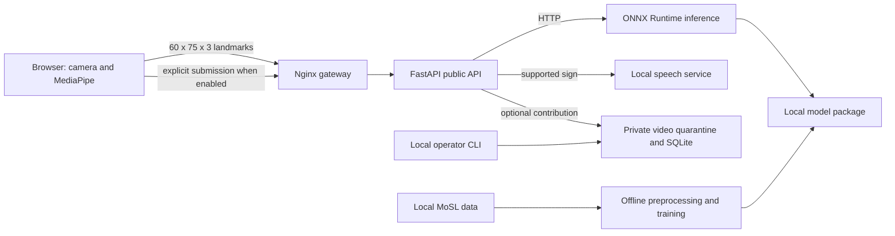

# Repository engineering audit — 2026-11-01

## Executive summary

The repository is a coherent research prototype with a tested recognition contract,
protected local assets and substantial existing documentation. It is not a validated
15-sign product or a production-ready interpreter. This audit corrected misleading
privacy/architecture documentation and stale CI commands, improved onboarding and made
frontend installs lockfile-driven. It did not retrain, deploy, alter data, or change
recognition behavior. Docker runtime and a physical camera were unavailable for this
review. Prior reports are historical evidence, not current test results.

## Architecture and inventory

`apps/web` owns React/Vite, MediaPipe, segmentation and UI; `services/api` validates
requests and orchestrates inference/speech and the separate optional contribution path;
`services/inference` loads the ONNX package; `services/speech` provides local synthesis;
`ml` owns offline data and model tooling. `packages/contracts` holds language-neutral
schemas, `infrastructure` Nginx, `tests` cross-service checks, `scripts` verification,
`artifacts` reports/model metadata, and `.github` CI/community files. No restructuring
was justified. Python service projects declare Python >=3.12; CI and containers use
3.12. Frontend uses React 18, Vite 8, npm lockfile and Node 22 in CI. Torch 2.5.1,
ONNX Runtime and NumPy support offline training; container builds use pinned service
locks. The optional contribution store uses SQLite and local or S3 objects; it is not
a dependency of recognition. See [architecture](../architecture/overview.md) and
[configuration](../operations/configuration.md).

## Code quality and cleanup

Existing separation, strict schemas, package checksum checks and focused tests provide
useful boundaries. The API's contribution service and offline training pipeline remain
complex due to media validation, lifecycle management and research constraints; no
behavior-preserving rewrite was established as safer than leaving them intact. Outdated
claims that all camera pixels stay local and that the API has no storage were corrected.
The stale backend CI test path and ML CI dependency/module references were repaired;
speech checks were added to CI and Docker build coverage. Changes are localized.

| Candidate | Evidence and action | Risk / verification |
| --- | --- | --- |
| Raw videos, landmark caches, ONNX, checkpoints, reports and MediaPipe task | Active or historical research value; preserved | High cost of loss; hashes checked below |
| Ignored `.DS_Store`, caches, `dist`, `node_modules` | Generated/local; preserved because cleanup adds no tracked value | Low impact; not needed for change |
| Historical smoke model and provenance | Historical/research value; preserved | Do not treat as active model |
| Dependencies | Production npm audit reported React Router advisories; no dependency removed | Full fix requires major upgrade; see risks |
| Other orphan candidates | No candidate proved safe across dynamic loading, tests and research workflows | Preserve pending targeted investigation |

`.gitignore` excludes raw/processed data, model binaries, env files, private contribution
storage and common caches. A tracked-filename check found no obvious secret/credential
files; this is not a full secret or history scan. No claim is made that credentials have
never been committed. Python development and ML dependencies use ranges, so their
resolution can drift even though runtime service containers have locks.

## AI/ML assessment

The local tree contains 2,216 video files and 2,216 manifest rows; the manifest hash and
protected model hashes match the previously recorded values. Earlier dataset audit reports
2,197 unique binary checksums, 19 duplicate extras, 15 invalid-label videos, 11 eligible
labels / 59 examples after exclusions, and no signer identity. Those detailed quality,
duration, decoding and split findings were not independently recomputed in this audit.
The [dataset card](../datasets/mosl-video-dataset-card.md) and
[attribution](../datasets/mendeley-mosl-v1-attribution.md) retain provenance: upstream
metadata records CC BY 4.0, while rights and privacy must be checked before sharing
local videos or derived weights. Do not combine data across languages without validation.

Offline preprocessing samples frames, extracts MediaPipe pose and hands, normalizes by
shoulder position/scale and produces 60 x 75 x 3 cached arrays and presence masks.
Face landmarks are excluded, limiting non-manual information; temporal resampling,
missing hands, pose, signer diversity and camera-domain differences affect quality.
The pipeline evaluates Transformer, bidirectional GRU and temporal-convolution/GRU
candidates. The selected local package is a three-class Transformer, not a 15-class
model. Prior held-out results used only three known examples and 68 OOV examples; 55.88%
OOV false acceptance and absence of signer-independent splits preclude generalization or
safety claims. Training and package validation tooling exist, but fresh preprocessing
setup is not fully reproducible because OpenCV/MediaPipe versions are not pinned.
Consult the [model card](../model-cards/mosl-isolated-sign-v1.md),
[preprocessing record](../datasets/preprocessing.md), and [ML guide](../../ml/README.md).

## Security and privacy

Recognition sends transient landmarks, not video, to the public API. The separate adult
contribution flow can submit identifiable video and personal metadata when explicitly
enabled; it defaults closed and uses quarantine, media validation, and review controls.
Controller/legal readiness, reference media, deployment storage security and operational
review are unconfirmed. The process-local rate limiter does not provide a shared
multi-instance limit. Browser testing with route mocks is not a physical-camera or
production-security assessment. Dependency scanning on 2026-11-01 reported two moderate
production React Router advisory entries; current static navigation uses fixed paths,
but applicability has not been fully assessed. The audit also reported 19 moderate and
6 high findings including development dependencies in the restored lockfile;
a full dependency and reachability review is still needed. No legal compliance is claimed.

## Validation

Baseline on the existing local environment: `make test-all` passed architecture 14, API
75, inference 29, ML 31, speech 9, frontend 42; Playwright 6 passed, 2 skipped because
the Docker/fake-camera prerequisites were unavailable. Python Ruff/MyPy, frontend ESLint,
TypeScript and Vite build passed as part of that command. `make compose-check` passed.
Docker daemon was unavailable; build, startup, health, real gateway and physical-camera
checks were not executed. Historical metrics and earlier Docker results are not current
validation. Final `make test-all` repeated the same counts: architecture 14, API 75, inference 29,
ML 31, speech 9 and frontend 42 passed; Playwright 6 passed and 2 skipped. Ruff,
MyPy, ESLint and the production build passed. `make compose-check`, the documentation
link test and `git diff --check` passed. The five protected model, mapping, manifest and
MediaPipe asset hashes matched their historical values. These checks do not establish
model accuracy or validate the changed CI on a fresh hosted runner.

## Documentation and collaboration

Updated README, contributor guide, architecture/privacy/API, dataset provenance and
licensing, local operations, ML setup and roadmap. New contributors can navigate the
code and run tests with the documented environment, but a fresh clone lacks ignored
model and data assets; authorized provisioning and reproducible preprocessing setup are
onboarding blockers for real inference and retraining. Hosted CI changes still require a
real GitHub Actions run.

## Prioritized debt and next steps

- **P0:** None verified by this audit; this is not a full penetration test.
- **P1:** Obtain ethically sourced, rights-cleared, signer-identified, multi-signer
  repetitions for a 15-sign target, with community validation and signer-disjoint splits.
- **P1:** Evaluate out-of-vocabulary rejection and real physical-camera performance;
  current data do not justify real-world accuracy claims.
- **P1:** Review React Router advisory applicability and test a supported major upgrade;
  audit development and Python dependencies separately.
- **P1:** Keep contribution collection closed until legal, reference-media, privacy,
  storage and operational requirements are evidenced.
- **P2:** Pin and document a clean preprocessing environment; verify CI on fresh runners
  and document authorized model/data provisioning without distributing restricted assets.
- **P3:** Periodically reassess candidate cleanup and old historical reports; retain
  ambiguous research artifacts until their provenance and dependencies are understood.
