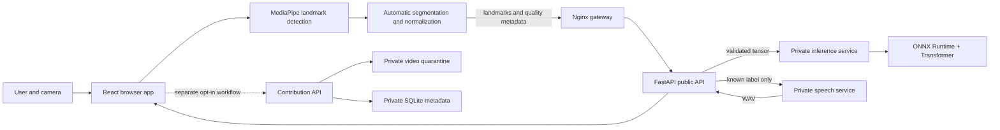

# OpenSign Darija: detailed technical report

**Repository review:** 2026-10-31 
**Scope:** current working tree, including uncommitted changes. This is a code and documentation review, not a new test run. Performance and test results below are historical measurements reported by the project, not independently rerun for this report. Some local models and data are ignored by Git and may not exist in a fresh clone.

## 1. Executive overview

OpenSign Darija is a research prototype for recognizing a small set of **isolated Moroccan signs** using a camera. Its main pipeline detects body and hand landmarks in the browser, automatically segments a possible sign, sends numerical landmarks to an API, classifies the sequence using a locally hosted ONNX model, displays the corresponding Arabic text, and attempts to speak known results.

The active vocabulary has only **three labels**: `اب` (أَبٌ), `احب` (أَحَبَّ), and `سوق` (سُوقٌ). It does not translate continuous signing or sentences. The model was trained on only nine examples, with three validation and three test examples. Its measured out-of-vocabulary false acceptance is high. The project is consequently a **limited research baseline**, not a reliable interpreter or production-ready accessibility service.

The current working tree also contains a separate, optional adult volunteer video-contribution feature at `/contribute`. It collects a different set of five intended signs and is closed by default until configuration and reference-video gates are satisfied. Contributions are quarantined and are not automatically used for training. Older core documentation predates this feature and incorrectly describes contribution routes as absent from the current tree.

## 2. Purpose and functional boundaries

The core user journey is:

1. A user opens the recognition page and activates the camera.
2. The browser runs MediaPipe on camera frames locally.
3. Browser logic observes movement and hand/pose visibility to start and finish a candidate sign automatically.
4. The candidate is normalized and sampled to 60 frames, each containing 75 landmarks with three coordinates.
5. The public API validates the request and rejects poor-quality candidates or calls the internal inference service.
6. The inference service runs the active Transformer exported to ONNX, applies calibrated rejection, and returns a prediction or UNKNOWN.
7. The browser displays the result; for supported results it asks the API for speech, then waits for a cooldown and reset.

The system is a **closed-set classifier with a rejection layer**, not an open-ended language model. Its model chooses among three learned classes; UNKNOWN is a decision produced by quality and confidence rules. A high confidence score is not proof of a correct sign.

## 3. Architecture

**Trust boundaries:** in the recognition flow, camera pixels stay in the browser; normalized landmarks and metadata cross the browser/API boundary. Inference and speech are internal services on the Docker network. The separate contribution flow intentionally uploads recorded video after explicit submission and, unlike anonymous recognition, collects identifying information. The two flows have different privacy properties.

### Runtime components

| Component | Responsibility | Principal technologies |
|---|---|---|
| Browser app | Interface, camera access, local detection, segmentation, result and audio | React 18, TypeScript, Vite, React Router, MediaPipe Tasks Vision, browser media APIs |
| Gateway | Single public entry point, static and API routing | Nginx, Docker Compose |
| Public API | Request validation, quality gates, orchestration, sign speech and contribution endpoints | Python 3.12+, FastAPI, Pydantic, HTTPX, Uvicorn |
| Inference | Load/validate model package, execute and calibrate predictions | FastAPI, NumPy, ONNX Runtime CPU |
| Speech | Local speech generation and WAV validation | FastAPI, local system Arabic TTS, browser fallback |
| Optional contributions | Consent/status, upload validation, quarantine and review administration | FastAPI, SQLite, FFmpeg/FFprobe, local storage or S3-compatible storage via boto3 |
| Offline ML | Dataset auditing, landmark preprocessing, training, evaluation and export | Python, MediaPipe, PyTorch, NumPy, ONNX, ONNX Runtime |
| Quality tooling | Unit, integration, browser and architecture/privacy tests | pytest, Vitest, Playwright, ESLint, Ruff, MyPy |

The default Compose stack contains `web`, `api`, `inference`, `speech`, and `nginx`; an `ml-audit` service is available under the optional ML profile. SQLite and a contribution data volume are used only by the optional contribution subsystem; there is no active PostgreSQL, Redis, or MinIO service in the default stack. An S3-compatible adapter exists but is not the default.

### Repository map

| Path | What it contains |
|---|---|
| `apps/web/` | React interface, camera, landmark processing, segmentation, speech playback, contribution UI and frontend tests |
| `services/api/` | Public API, recognition orchestration, input protection and optional contribution management |
| `services/inference/` | Model package validation, ONNX loading, prediction and UNKNOWN logic |
| `services/speech/` | Local speech synthesis, normalization and audio validation |
| `ml/` | Local dataset tooling, preprocessing, model definitions, training, evaluation and export |
| `artifacts/models/` | Local model packages, labels, configuration, calibration, metrics and integrity files |
| `packages/contracts/` | Language-neutral recognition contract/schema |
| `infrastructure/` | Gateway and container infrastructure |
| `docs/` | Architecture, datasets, model cards, operations, testing and prior reports |
| `scripts/` and `tests/` | Benchmarking, checks, cross-service architecture and privacy tests |
| `.agent/CONTINUITY.md` | Workspace continuity and historical project decisions |

References: [architecture overview](../architecture/overview.md), [repository map](../architecture/repository-map.md), [Compose configuration](../../docker-compose.yml).

## 4. Browser processing and segmentation

### 4.1 Camera and landmarks

The application uses the browser camera API and MediaPipe Holistic Landmarker. For recognition it retains **33 pose landmarks, 21 left-hand landmarks and 21 right-hand landmarks**, for a total of 75 landmarks. Face landmarks are not part of this recognition tensor. Each landmark has `x`, `y`, and `z`; MediaPipe's `z` is relative depth and should not be interpreted as a verified physical 3D measurement.

The browser attempts CPU-first MediaPipe initialization. Current project continuity records a 24 FPS detector scheduling target; older benchmark reports cite 20 FPS. Effective FPS depends on hardware, frame scheduling and model execution. The packaged model and WASM must be available locally for offline detection.

### 4.2 Automatic segmentation

The segmenter is implemented in [automatic-segmentation.ts](../../apps/web/src/features/recognition/domain/automatic-segmentation.ts). It keeps recent frames, detects the beginning and end of a gesture and manages cooldown/reset. Its default settings are:

| Parameter | Default | Role |
|---|---:|---|
| Pre-roll / post-roll | 8 / 3 frames | Preserve context around detected boundaries |
| Dynamic start | energy ≥ 0.12 for 2 frames | Detect sustained motion |
| Stable end | energy ≤ 0.045 for 420 ms | Detect end of motion |
| Static dwell | 750 ms | Identify a stable, non-rest hand configuration |
| Candidate duration | 500–6,000 ms | Bound browser captures |
| Minimum usable browser frames | 8 | Avoid generating very sparse candidates |
| Cooldown / stable reset | 800 / 350 ms | Prevent immediate repeated capture |
| Duplicate window / similarity | 3,000 ms / 0.985 | Suppress repeated held poses |

The server has independent quality gates, including by default a stricter minimum of 12 usable frames, so passing browser segmentation does not guarantee server acceptance. Dynamic and static signs follow different movement rules. Hand zones and shoulder-relative measurements help distinguish signing from rest; the algorithm uses heuristic thresholds, not a separately trained boundary detector. Its performance on diverse live camera conditions is not established.

The lifecycle is `CAMERA_OFF → INITIALIZING → WAITING_FOR_SIGN → CAPTURING → RECOGNIZING → DISPLAYING → SPEAKING → COOLDOWN → WAITING_FOR_SIGN`; UNKNOWN skips speech. Errors are recoverable. Details: [recognition flow](../architecture/automatic-recognition-flow.md).

### 4.3 Feature representation

The canonical schema is `OPEN_SIGNE_LANDMARK_SCHEMA_V1`, with model input shape **`[batch, 60, 75, 3]`**, float32. The browser samples each candidate uniformly to 60 frames. Landmark coordinates are centered on the midpoint of the shoulders and scaled by shoulder width; missing coordinates are represented as zeros and a presence mask accompanies the API request. Left and right hands remain distinct and horizontal mirroring is not applied by default because handedness can affect meaning. Offline preprocessing also documents padding and truncation for fixed-length data; it should not be assumed to use the browser's exact sampling operation in every path. The ONNX model itself receives the landmark tensor and derives a frame mask from all-zero frames, rather than receiving the API presence mask as a separate ONNX input. See [landmark schema](../architecture/landmark-schema-v1.md) and [model source](../../ml/models/mosl_v1.py).

## 5. API and inference flow

The core public endpoints include `GET /api/v1/health`, `GET /api/v1/version`, `POST /api/v1/recognitions/word`, and `POST /api/v1/speech/sign`. The API validates tensor dimensions, finite numerical values, schema version, quality/segmentation metadata and forbidden extra fields. Limits include payload size, duration and rate. Depending on configuration, quality checks reject insufficient usable frames, missing hand/pose data, excessive missingness, unreliable boundaries and inadequate motion for a dynamic candidate.

A valid candidate is sent to private `POST /predict/word`. The inference runtime loads the model, labels and calibration from the local model package, performs package and checksum checks, executes ONNX Runtime and returns a decision. The public response is a compact recognized/UNKNOWN result; internal top-k information need not be exposed in the UI. For speech, the browser submits a known `label_key`; the public API resolves the approved Arabic label rather than accepting arbitrary browser text. Internal speech synthesis returns audio for playback; the client can try browser speech if service audio or playback fails.

The contribution router adds separate status, catalog, notice and submission/receipt surfaces under `/api/v1/contributions`. These are distinct from the core recognition endpoints. Consult [API documentation](../operations/api.md) together with [current router](../../services/api/app/api/v1/router.py): the former predates the addition of contribution routes.

## 6. Dataset and preprocessing

The project's recorded local MoSL audit reports 2,216 readable video rows: 1,941 Diverse, 130 Numbers, 71 Letters, 59 Days/Months/Seasons, and 15 Pronouns. There are 2,197 distinct binary checksums; 10 ambiguous duplicate groups covering 29 rows were excluded from training. The audit identifies 1,591 valid non-empty normalized label keys, but most do not have enough independent examples. Twenty-nine normalized keys have ambiguous Arabic display mappings and are excluded from the relevant training scope.

All 2,216 rows were reportedly preprocessed or served from checksum-keyed caches, with zero preprocessing failures in the recorded run. The saved NPZ caches contain landmark sequences, presence masks and provenance/quality metadata. Warnings include low hand detection and duplicate metadata collisions. A minimum-five usable-example rule yields 11 eligible labels and 59 samples, with a 37/11/11 train/validation/test split. The chosen active lexical scope narrows that to three classes, each with five examples: **9 train, 3 validation, 3 test** in total. Each class has only one validation and one test example.

Splitting is deterministic, seed 42, stratified by label and grouped by binary checksum to avoid the same video bytes crossing splits. However, signer identities are absent: **signer-independent evaluation cannot be claimed**. Licensing and rights must be reviewed before redistributing videos or derived weights. See [dataset card](../datasets/mosl-video-dataset-card.md), [preprocessing](../datasets/preprocessing.md) and [dataset licensing](../datasets/licensing.md).

## 7. Machine learning algorithms

### 7.1 Active Transformer classifier

The active model is `mosl-isolated-sign-v1`, a lightweight Transformer encoder defined in [mosl_v1.py](../../ml/models/mosl_v1.py). Its forward pass is:

1. Validate `[B, 60, 75, 3]`; flatten each frame to a 225-dimensional feature vector.
2. Project each frame from 225 to a 64-dimensional embedding using a linear layer, layer normalization and GELU activation.
3. Add learned positional embeddings so the model has information about frame order.
4. Pass the sequence through **two Transformer encoder layers**, each with **four attention heads**, a 128-dimensional feed-forward sublayer and 0.15 dropout.
5. Apply masked mean pooling over usable frames, then layer normalization, dropout and a linear classification head producing three logits.

Self-attention allows each frame representation to incorporate information from other frames. Positional embeddings provide ordering information, while pooling converts the sequence to a single fixed-length representation. All-zero frames are masked; a safe fallback avoids an entirely masked sequence inside the model, although upstream validation is expected to reject unusable input. The model contains **85,699 parameters** and the ONNX file is recorded as 411,736 bytes.

### 7.2 Training and candidates

The recorded active training configuration specifies 40 epochs, batch size 8, learning rate 0.001, weight decay 0.0001, gradient clipping at norm 1.0, class-weighted loss, balanced sampling, early-stopping patience 8, and checkpoint recovery. Augmentations include temporal resampling, dropping up to four frames, small coordinate noise and limited scale/translation changes; horizontal mirroring is disabled. The project reports a 1.789-second training run, which reflects the tiny dataset and local environment rather than a general training-time promise.

Three architectures were compared on the same declared validation scope:

| Candidate | Validation macro F1 | Validation OOV rejection | Recorded mean / P95 ONNX latency | Parameters |
|---|---:|---:|---:|---:|
| Bidirectional GRU | 1.000 | 54.4% | 1.168 / 1.247 ms | 64,899 |
| Temporal convolution + bidirectional GRU | 1.000 | 47.1% | 1.576 / 1.680 ms | 89,987 |
| Lightweight Transformer | 1.000 | 58.8% | 0.647 / 0.735 ms | 85,699 |

The selected Transformer used validation-only model/scope selection according to the project report. The validation set contained only three known examples, so the perfect validation F1 is highly unstable and cannot establish that the Transformer is generally superior. The latencies are direct local CPU measurements over 40 runs, not total user-perceived latency. Configuration: [training-config.yaml](../../artifacts/models/mosl-isolated-sign-v1/training-config.yaml); methodology and benchmark: [core report](core-recognition-process-final-report.md).

### 7.3 UNKNOWN and calibration

The classification head always emits class logits. To avoid always presenting one of the three classes, the pipeline first applies quality rejection and then temperature-scaled softmax. With logits `z`, temperature `T = 0.5` and class `i`, the normalized score is `p_i = exp(z_i/T) / sum_j exp(z_j/T)`. Acceptance requires the highest probability to meet a threshold of `0.0` **and** the difference between the highest and second-highest probabilities to meet approximately `0.8493`. The margin, rather than the zero probability threshold, is therefore the meaningful confidence gate in this package.

On the recorded held-out evaluation:

| Metric | Result | Interpretation |
|---|---:|---|
| Closed-set top-1 accuracy | 66.67% | 2 correct out of 3 known test samples |
| Closed-set top-3 accuracy | 100% | With only three classes, top-3 includes every class and is not discriminating |
| Macro F1 | 0.5556 | Very unstable with one test example per class |
| Balanced accuracy | 66.67% | Same small test-set limitation |
| OOV rejection | 44.12% of 68 OOV examples | Many unseen signs were not rejected |
| OOV false acceptance | 55.88% of 68 OOV examples | More than half of this OOV set received an accepted known label |
| Known-correct acceptance | 66.67% of 3 known examples | Very small sample |

These OOV numbers apply to the reported test pool, not a proven population error rate. The calibration used three known validation examples and 68 OOV validation examples; its OOV validation rejection was 58.82%. The gap underscores the weakness of calibration on small samples. See [UNKNOWN calibration](../architecture/unknown-calibration.md) and [model card](../model-cards/mosl-isolated-sign-v1.md).

### 7.4 Export and runtime

PyTorch weights are exported to ONNX for CPU inference. The recorded package validation reports ONNX checker success, correct shape, checksum validation, matching top-k results and a maximum PyTorch/ONNX absolute output difference of approximately `1.19 × 10⁻⁷`. This demonstrates numerical export parity for tested inputs, not real-world predictive quality. The active package includes labels, supported-sign mappings, calibration, schema, metrics, provenance and checksums alongside the ONNX file. An older two-class package is marked technical smoke only and is not the active user model.

## 8. Speech synthesis

The speech service normalizes and validates text, limits concurrent synthesis, invokes a local system speech provider, and validates the resulting WAV. It offers an `ar-MA` identity and an Arabic fallback; these are system-based voices, not a demonstrated native Moroccan-Darija neural voice or voice clone. For the public recognition journey, the browser sends an allowed label key rather than free text. If server playback fails, the app can use a browser voice. Naturalness, accent quality and physical-device audible-start latency remain unverified. See [speech operations](../operations/speech.md) and [speech model card](../model-cards/speech-service.md).

## 9. Optional contribution subsystem

The separate `/contribute` workflow is designed for adults volunteering a short video of `salam`, `chokran`, `tabib`, `mosaada`, or `maa`. These five collection targets are **not** the active model's three recognized labels. A browser can guide recording and preview; an explicit multipart submission includes name, age, city, selected sign, consent and video. The API validates allowed fields, consent, origin/rate restrictions, file size, duration, media type and actual media decoding using bounded FFprobe/FFmpeg processes.

Data go to a private quarantine; metadata and identity information are separated into linked SQLite tables, and video object keys use UUIDs. Local files or private S3-compatible storage are supported. Review, rights, retention and export are separate administrative workflows; the contribution does not automatically enter training. Collection is closed by default and requires complete controller/rights/retention/CNDP configuration and approved reference videos. The project report says approved reference MP4s are currently absent, so public collection should remain closed. This is an engineering description, not a legal determination. See [contribution architecture](../contributions/architecture.md), [data flow](../contributions/data-flow.md) and [feature report](community-video-contribution-feature-report.md).

## 10. Privacy, safety and security

- **Recognition:** the design processes camera frames in the browser and sends landmarks and metadata, not camera video or microphone audio. Landmark data can still be sensitive; avoiding raw video is not the same as proving anonymity or eliminating privacy risk.
- **Contributions:** this is an explicit, separate video and personal-data collection path. Its threat model, retention and legal basis differ from recognition.
- **Service exposure:** public traffic passes through Nginx; inference and speech are private Docker services. Validation uses closed schemas and prohibits extra media fields on recognition requests.
- **Integrity:** the active model package uses checksums, shape/schema checks and loading validation. These do not by themselves establish the safety of a prediction or the provenance of a maliciously replaced package and checksum together.
- **Abuse control:** configurable request-size and rate controls exist. For a multi-instance production deployment, shared enforcement and operational security need explicit review.
- **Output safety:** UNKNOWN is not spoken. However, the observed 55.88% OOV false-acceptance rate means this behavior cannot be treated as a robust safety barrier.

## 11. Testing and performance evidence

The repository contains Python unit/integration tests, frontend unit tests, browser tests, contract/privacy and architecture checks, plus benchmark and verification scripts. A historical 2026-07-23 report records 54 API tests, 25 inference tests, 31 ML tests, 8 speech tests, 30 frontend unit tests and 5 Playwright tests passing, together with lint/type checks and Docker validation. These counts describe that earlier tree, not a fresh result for the present uncommitted working tree. A later contribution feature report describes its own additional tests, Docker upload exercise and a skipped real-video fake-camera scenario.

The historical core report records a local API round trip of 45.523 ms mean / 59.666 ms P95 over 20 requests, and direct ONNX 0.647 / 0.735 ms over 40 runs. Such measurements depend on machine, payload, warm-up and environment and exclude much of the camera-to-result journey. The documented browser test used prerecorded/fake camera input; it is not evidence of a successful live physical-camera trial. Physical-camera/person tests, varied lighting, real signers, mobile behavior and representative device audio remain unconfirmed in the reports. See [testing strategy](../architecture/testing-strategy.md), [physical-camera plan](../testing/physical-camera.md), and [core report](core-recognition-process-final-report.md).

## 12. Main gaps and recommendations

1. **Improve data first.** Obtain consented, rights-cleared examples from many signers across devices, settings, body types, hand use and signing speeds. Record signer identity in a privacy-respecting way so signer-disjoint splits are possible.
2. **Build realistic evaluation.** Keep an untouched signer-disjoint test set and representative live-camera recordings; measure per-class accuracy, confusion, segmentation failures and OOV false acceptance with uncertainty intervals and realistic prevalence.
3. **Improve UNKNOWN behavior.** Gather representative unseen signs and rest/noise conditions, evaluate calibration on independent data and set acceptance criteria appropriate to the intended application. Do not interpret confidence as guaranteed correctness.
4. **Validate the full experience with the Deaf community.** Verify sign meanings and Arabic/Darija labels with qualified Moroccan signers; evaluate usability, consent materials and consequences of errors.
5. **Test deployment and privacy controls.** Assess rate limiting across instances, TLS, secret management, storage access, monitoring, backups, deletion and incident response before any public deployment or contribution opening.
6. **Keep documentation synchronized.** Update older core API/dataset descriptions that say contribution routes or uploads are absent; retain their dates and explain that they describe the earlier architecture.
7. **Expand scope deliberately.** Additional signs require sufficient representative examples, independent testing and a validated release process. Continuous sign translation, grammatical generation and general language understanding are separate research problems.

## 13. Running and navigating

For a local Docker setup, the documented commands are `docker compose build`, `docker compose up -d`, and `docker compose ps`; the default app URL is `http://localhost:8081/app/recognition`. Required ignored local assets must be present. `make help`, `make test-all`, `make compose-check`, `make architecture-check`, and `make verify` expose project workflows. Consult [local development](../operations/local-development.md), [Docker operations](../operations/docker.md), and [model assets](../operations/model-assets.md) before running them.

**Review limitation:** no models were retrained, no datasets were modified, no external research was performed, and no tests were rerun for this report. Findings rely on the inspected current source, configuration and explicitly identified historical artifacts.
